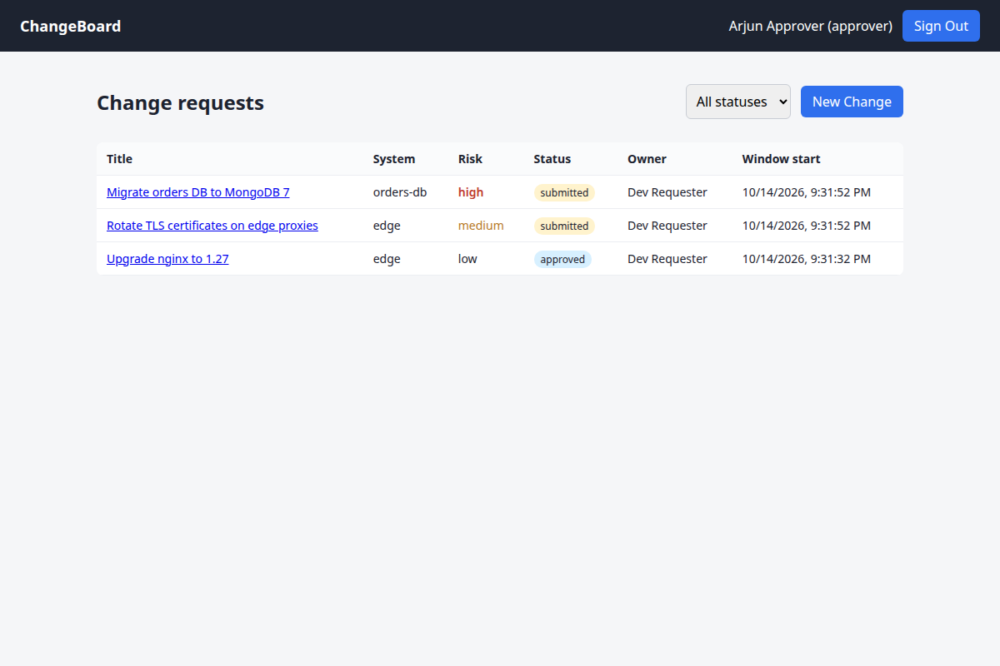
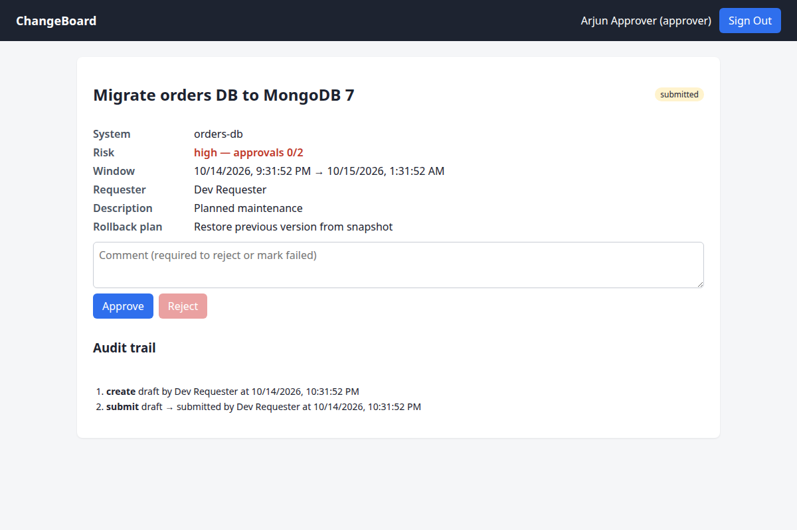

# ChangeBoard

A change-management app for operations teams: engineers file a **change request**
("upgrade payments to v2.4, Saturday 02:00–04:00, rollback = redeploy v2.3"), approvers
review it, and the change can only be carried out inside its approved window. Every step
is recorded in an audit trail.

**Stack:** TypeScript, Node.js, Express 5, MongoDB (Mongoose), React + Vite, JWT, Zod,
Vitest + Supertest, Docker Compose, nginx, GitHub Actions.




## Features

- **Workflow enforced on the server.** A pure state machine (`server/src/changes/workflow.ts`)
  decides every transition: draft → submitted → approved → in_progress → completed, plus
  reject/revise, fail/rollback and cancel. The API returns `allowedActions` for the current
  user, so the UI never duplicates the rules.
- **Role-based access control:** requester, approver, admin. Self-registration always makes a
  requester; only admins grant roles.
- **Separation of duties:** nobody can approve their own change, admins included.
  **High-risk changes need two different approvers.**
- **Change windows:** a change can only be started between `windowStart` and `windowEnd`.
- **Optimistic concurrency:** every write is conditional on a `version` field, so two approvers
  clicking at the same moment can't both succeed; the loser gets `409 Conflict`.
- **Atomic audit trail:** history is embedded in the change document, so the status change and
  its audit entry are one single-document write (MongoDB guarantees single-document atomicity).
- **Keyset (cursor) pagination** on `_id`, backed by compound indexes.
- **Security basics:** bcrypt password hashing, JWT with a pinned algorithm, login rate limit,
  helmet headers, Zod validation on every input, identical errors for unknown email and wrong
  password.
- **Ops-ready:** `/health` readiness endpoint, Docker health checks, graceful shutdown on
  SIGTERM, multi-stage Docker images running as a non-root user.

## Run it

```bash
docker compose up -d --build              # web on http://localhost:8080
docker compose exec api node dist/seed.js # demo users, password "password123"
```

Demo users: `dev@example.com` (requester), `approver1@` / `approver2@example.com`
(approvers), `admin@example.com`.

### Development

```bash
docker run -d -p 27017:27017 mongo:7
cd server && npm i && JWT_SECRET=dev-secret-that-is-at-least-32-chars npm run dev
cd web && npm i && npm run dev            # http://localhost:5173, proxies /api to :4000
cd server && npm test                     # 25 tests: workflow rules + API against real MongoDB
```

## API

| Method | Path | Who | Notes |
|---|---|---|---|
| POST | `/api/auth/register` | anyone | creates a requester |
| POST | `/api/auth/login` | anyone | returns a JWT (1 h) |
| GET | `/api/auth/me` | signed in | |
| GET | `/api/changes?status=&risk=&mine=&limit=&cursor=` | signed in | newest first, `nextCursor` for the next page |
| POST | `/api/changes` | signed in | creates a draft |
| GET | `/api/changes/:id` | signed in | includes history and `allowedActions` |
| PATCH | `/api/changes/:id` | owner | drafts only |
| POST | `/api/changes/:id/actions/:action` | depends | `submit approve reject revise start complete fail rollback cancel`; body `{ "comment": "..." }` |
| GET | `/api/users` | admin | |
| PATCH | `/api/users/:id/role` | admin | |

Errors: `400` invalid input, `401` no/invalid token, `403` not allowed for your role,
`404` not found, `409` wrong state or concurrent edit, `422` business rule (outside window,
missing comment).

## Layout

```
server/src/
  app.ts               express app: middleware, routers, error handler
  server.ts            connect to MongoDB, listen, graceful shutdown
  config.ts            env validation (fails fast on a missing JWT_SECRET)
  auth/                login/register, JWT, requireAuth / requireRole
  changes/workflow.ts  the state machine (pure, unit-tested)
  changes/service.ts   reads, conditional writes, pagination
  changes/routes.ts    request validation and HTTP mapping
web/src/               React SPA (login, list, detail, new change)
web/nginx.conf         serves the SPA, proxies /api to the API container
```
